# Apache: HTTPS

**Despliegue de Aplicaciones Web** · Sergio Segoviano Gálvez · 2º DAW

## Índice

1. [Investigación](#investigación)
    1. [Funcionamiento de HTTPS](#funcionamiento-de-https)
    2. [Tipos de certificados SSL/TLS](#tipos-de-certificados-ssltls)
    3. [Módulos de Apache necesarios](#módulos-de-apache-necesarios)
2. [Implementación](#implementación)
    1. [Instalación y estado de Apache](#instalación-y-estado-de-apache)
    2. [Activación de los módulos ssl y headers](#activación-de-los-módulos-ssl-y-headers)
    3. [Generación del certificado](#generación-del-certificado)
    4. [VirtualHost en el puerto 443](#virtualhost-en-el-puerto-443)
    5. [Redirección de HTTP a HTTPS](#redirección-de-http-a-https)
    6. [Reinicio de Apache](#reinicio-de-apache)
3. [Verificación](#verificación)
4. [Banco de pruebas](#banco-de-pruebas)
5. [Conclusiones](#conclusiones)
6. [Bibliografía](#bibliografía)

## Investigación

### Funcionamiento de HTTPS

HTTPS es HTTP enviado dentro de una conexión cifrada con **TLS** (*Transport Layer Security*), el sucesor de SSL. Usa por defecto el puerto **443**, en lugar del 80 de HTTP.

Antes de enviar ninguna página, el navegador y el servidor hacen el **handshake TLS**:

1. El navegador se conecta y indica las versiones de TLS y los algoritmos de cifrado que admite.
2. El servidor elige unos y envía su **certificado**, que contiene su clave pública y el dominio para el que es válido.
3. El navegador comprueba el certificado: que no esté caducado, que corresponda al dominio y que lo haya firmado una autoridad de certificación (CA) en la que confía.
4. Ambos acuerdan una **clave de sesión simétrica**, que solo conocen ellos dos.
5. A partir de ahí, todas las peticiones y respuestas HTTP viajan cifradas con esa clave.

HTTPS aporta tres garantías:

| Garantía | Qué significa |
| --- | --- |
| Confidencialidad | Nadie en la red puede leer lo que se envía (contraseñas, cookies, formularios). |
| Integridad | Nadie puede modificar los datos por el camino sin que se detecte. |
| Autenticación | El certificado demuestra que el servidor es realmente el del dominio. |

Es importante porque, sin HTTPS, cualquiera en la misma red puede leer el tráfico. En la práctica anterior, la autenticación básica enviaba el usuario y la contraseña solo codificados en Base64, así que con HTTP se podían leer. Además, los navegadores marcan como «No seguro» las páginas HTTP, y funciones como HTTP/2 o la geolocalización solo están disponibles con HTTPS.

### Tipos de certificados SSL/TLS

| | Autofirmado | Firmado por una CA de confianza |
| --- | --- | --- |
| Quién lo firma | El propio servidor | Una autoridad de certificación (Let's Encrypt, DigiCert…) |
| Coste | Gratis | Gratis (Let's Encrypt) o de pago |
| Cifrado | El mismo que uno de una CA | El mismo |
| Aviso en el navegador | Sí, «riesgo potencial de seguridad» | No, aparece el candado |
| Requisitos | Ninguno | Un dominio real accesible desde Internet |
| Uso | Pruebas, laboratorio, redes internas | Webs públicas |

Un certificado autofirmado cifra igual de bien, pero el navegador no puede comprobar la identidad del servidor porque ninguna CA lo respalda. Por eso avisa al usuario.

Los certificados de CA se clasifican además según lo que se comprueba antes de emitirlos: **DV** (solo que se controla el dominio), **OV** (también la organización) y **EV** (validación extendida de la empresa). Let's Encrypt emite certificados DV gratuitos de forma automática mediante el protocolo **ACME**. Para comprobar que controlas el dominio, el método más habitual es el reto **HTTP-01**: el cliente (Certbot) coloca un fichero en `http://dominio/.well-known/acme-challenge/` y Let's Encrypt lo descarga por el puerto 80. Los certificados tienen una validez corta y Certbot los renueva automáticamente.

### Módulos de Apache necesarios

| Módulo | Función | Estado en Ubuntu |
| --- | --- | --- |
| `mod_ssl` | Añade TLS a Apache: directivas `SSLEngine`, `SSLCertificateFile`, `SSLCertificateKeyFile`… | Instalado, pero desactivado |
| `mod_socache_shmcb` | Caché de sesiones TLS que necesita `mod_ssl` | Se activa solo al activar `ssl` |
| `mod_headers` | Permite añadir cabeceras de seguridad, como HSTS | Instalado, pero desactivado |
| `mod_alias` | Directiva `Redirect`, usada para la redirección a HTTPS | Activado por defecto |
| `mod_rewrite` | Alternativa para redirecciones con condiciones | Opcional, no se usa aquí |

En Ubuntu, el fichero `/etc/apache2/ports.conf` ya incluye `Listen 443` cuando `mod_ssl` está activo, así que no hace falta abrir el puerto a mano.

## Implementación

Se parte de la práctica anterior: Ubuntu 24.04 LTS en VirtualBox, Apache 2.4.58 y el sitio `sergio.example.com` (`/var/www/sergio`), resuelto mediante `/etc/hosts`.

### Instalación y estado de Apache

```bash
sudo apt update
sudo apt install apache2 -y
sudo systemctl status apache2
```

Apache ya estaba instalado, así que `apt` indica que está en su versión más reciente. El servicio aparece como `active (running)`.

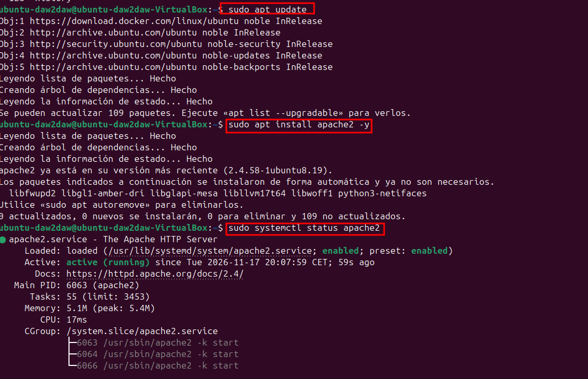

### Activación de los módulos ssl y headers

```bash
sudo a2enmod ssl
sudo a2enmod headers
sudo systemctl restart apache2
```

Al activar `ssl`, Apache activa también su dependencia `socache_shmcb`. Hace falta `restart` y no `reload`, porque se han cargado módulos nuevos.

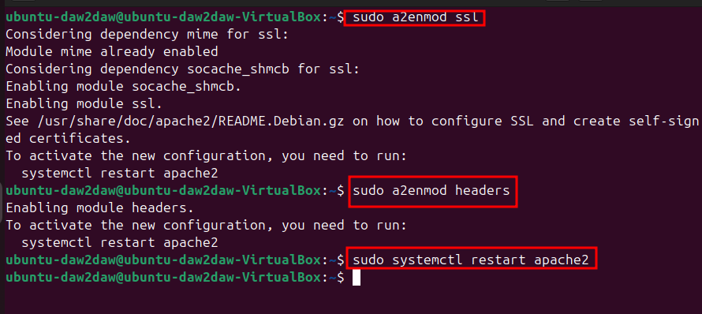

### Generación del certificado

#### Opción A: certificado autofirmado

Se genera la clave privada y el certificado con OpenSSL en un solo comando:

```bash
sudo openssl req -x509 -noenc -days 365 -newkey rsa:2048 \
  -keyout /etc/ssl/private/sergio.key \
  -out /etc/ssl/certs/sergio.crt \
  -subj "/C=ES/ST=Toledo/L=Villacanas/O=2DAW/CN=sergio.example.com" \
  -addext "subjectAltName=DNS:sergio.example.com"
```

| Opción | Función |
| --- | --- |
| `req -x509` | Crea directamente un certificado autofirmado, sin solicitud a una CA |
| `-noenc` | La clave privada no lleva contraseña, para que Apache arranque sin pedirla |
| `-days 365` | Validez de un año |
| `-newkey rsa:2048` | Crea una clave RSA nueva de 2048 bits |
| `-keyout` / `-out` | Dónde se guardan la clave privada y el certificado |
| `-subj` | Datos del certificado; `CN` es el dominio |
| `-addext subjectAltName` | Añade el dominio como nombre alternativo, que es lo que comprueban los navegadores actuales |

La clave privada queda en `/etc/ssl/private/`, una carpeta a la que solo puede acceder root. Se comprueban los datos del certificado:

```bash
sudo openssl x509 -in /etc/ssl/certs/sergio.crt -noout -subject -issuer -dates
```

El emisor (`issuer`) y el titular (`subject`) son el mismo, que es lo que define un certificado autofirmado.

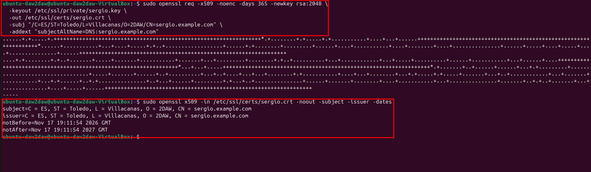

#### Opción B: Let's Encrypt con Certbot

Con un dominio real, el proceso sería:

```bash
sudo apt install certbot python3-certbot-apache -y
sudo certbot --apache -d midominio.com
sudo certbot renew --dry-run
```

Certbot obtiene el certificado, modifica el VirtualHost para usarlo, puede añadir la redirección a HTTPS y programa la renovación automática.

**En esta práctica no se puede usar.** `sergio.example.com` no es un dominio real: solo existe en el `/etc/hosts` de la máquina virtual, y la máquina no es accesible desde Internet. El reto HTTP-01 necesita que Let's Encrypt descargue un fichero del dominio por el puerto 80, así que la validación fallaría. Por eso se ha usado la opción A.

### VirtualHost en el puerto 443

Se crea un VirtualHost nuevo para HTTPS:

```bash
sudo nano /etc/apache2/sites-available/sergio-ssl.conf
```

```apache
<VirtualHost *:443>
    ServerAdmin sergio@example.com
    ServerName sergio.example.com
    DocumentRoot /var/www/sergio

    SSLEngine on
    SSLCertificateFile /etc/ssl/certs/sergio.crt
    SSLCertificateKeyFile /etc/ssl/private/sergio.key

    Header always set Strict-Transport-Security "max-age=31536000"
    Header always set X-Content-Type-Options "nosniff"

    <Directory /var/www/sergio/privado>
        AuthType Basic
        AuthName "Zona privada"
        AuthUserFile /etc/apache2/.htpasswd
        Require valid-user
    </Directory>

    ErrorLog ${APACHE_LOG_DIR}/sergio-ssl-error.log
    CustomLog ${APACHE_LOG_DIR}/sergio-ssl-access.log combined
</VirtualHost>
```

| Directiva | Función |
| --- | --- |
| `<VirtualHost *:443>` | El sitio escucha en el puerto de HTTPS |
| `SSLEngine on` | Activa TLS en este VirtualHost |
| `SSLCertificateFile` | Certificado del servidor |
| `SSLCertificateKeyFile` | Clave privada del certificado |
| `Strict-Transport-Security` | HSTS: indica al navegador que use siempre HTTPS durante un año. El navegador lo ignora mientras el certificado no sea de confianza |
| `X-Content-Type-Options` | Impide que el navegador interprete los ficheros con un tipo distinto al indicado |

El bloque `<Directory>` de la zona privada se copia del VirtualHost del puerto 80. Como todas las peticiones van a pasar a HTTPS, la protección tiene que estar también aquí. Así, el usuario y la contraseña de la autenticación básica viajan cifrados.

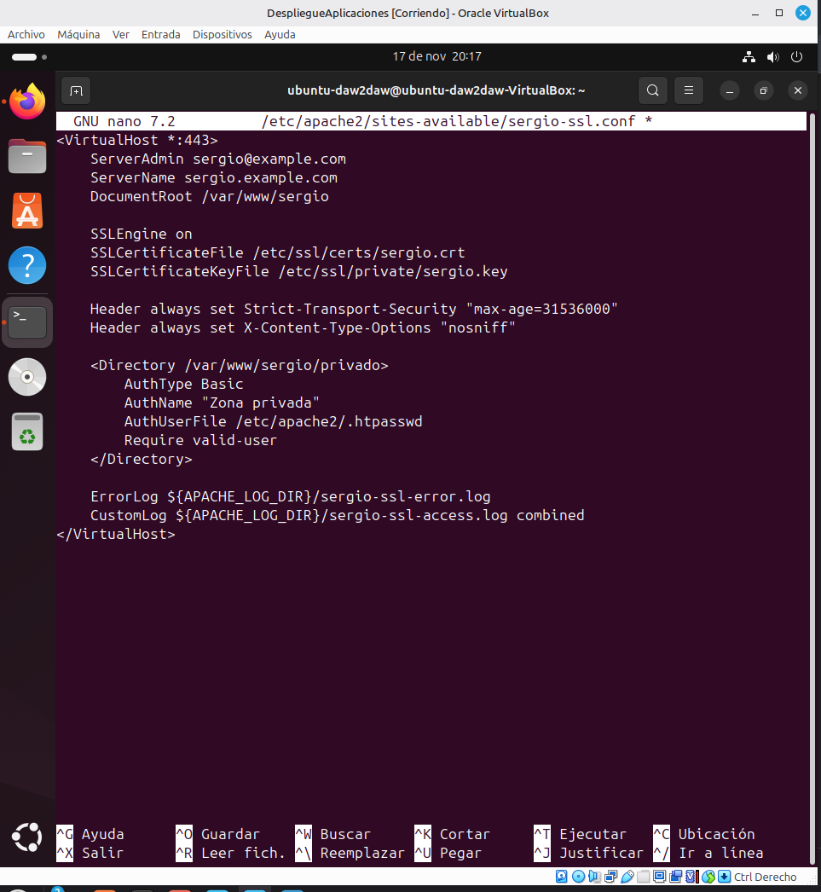

Se activa el sitio:

```bash
sudo a2ensite sergio-ssl.conf
```

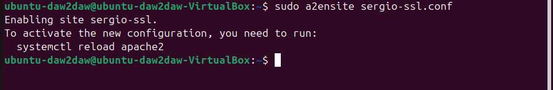

### Redirección de HTTP a HTTPS

En el VirtualHost del puerto 80 se añade una redirección permanente:

```bash
sudo nano /etc/apache2/sites-available/sergio.conf
```

```apache
<VirtualHost *:80>
    ServerAdmin sergio@example.com
    ServerName sergio.example.com
    DocumentRoot /var/www/sergio

    Redirect permanent / https://sergio.example.com/
    ...
</VirtualHost>
```

`Redirect permanent` devuelve un código **301** con la nueva dirección en HTTPS, de modo que cualquier petición por HTTP se envía automáticamente al sitio seguro.

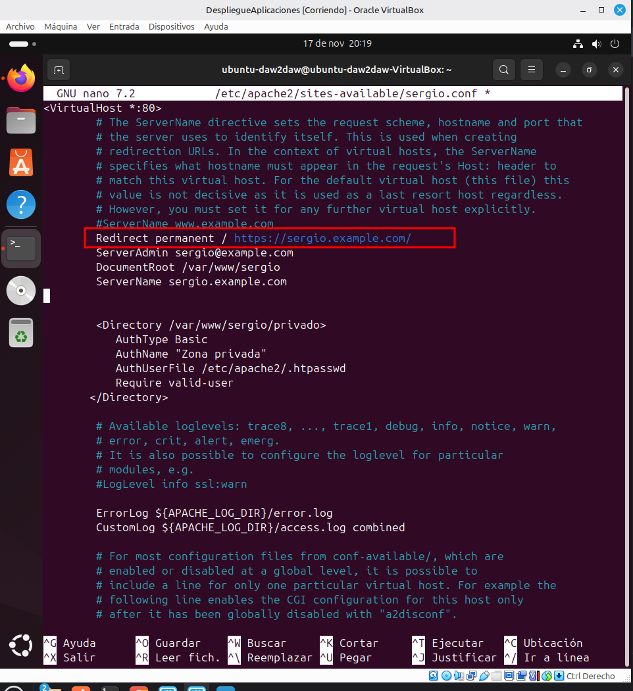

### Reinicio de Apache

```bash
sudo apache2ctl configtest
sudo systemctl restart apache2
sudo ss -tlnp | grep apache2
```

`configtest` debe devolver `Syntax OK`. Se usa `restart` porque `mod_ssl` lee el certificado y la clave al arrancar. `ss` muestra que Apache escucha en los puertos **80** y **443**.

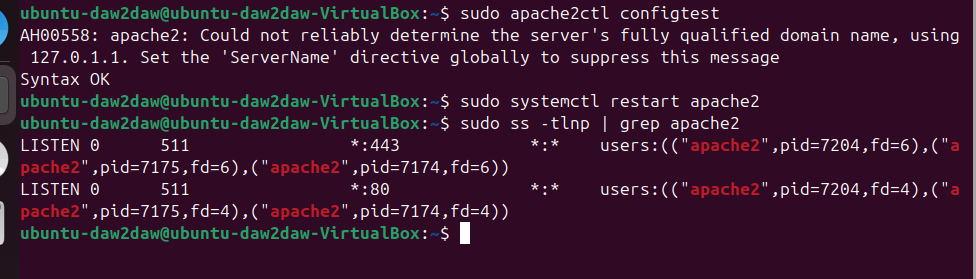

## Verificación

**Redirección.** Una petición por HTTP devuelve un 301 hacia HTTPS:

```bash
curl -I http://sergio.example.com
```

Debe aparecer `HTTP/1.1 301 Moved Permanently` y `Location: https://sergio.example.com/`.

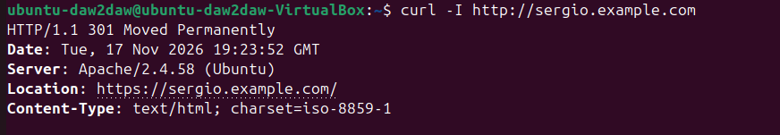

**Acceso por HTTPS.** Como el certificado es autofirmado, se usa la opción `-k` para que curl lo acepte:

```bash
curl -kI https://sergio.example.com
```

Debe aparecer `HTTP/1.1 200 OK` junto con las cabeceras `Strict-Transport-Security` y `X-Content-Type-Options`.

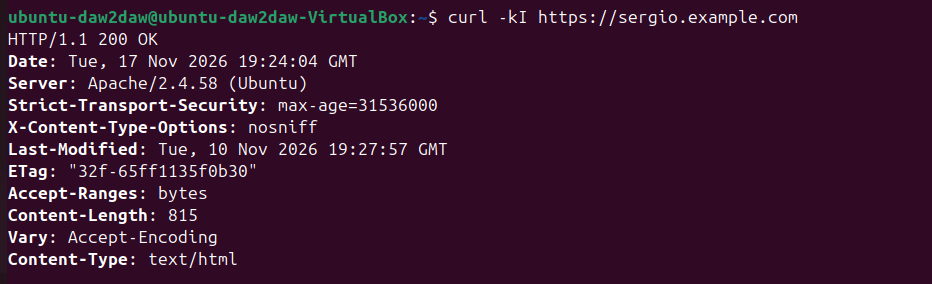

**Zona privada por HTTPS:**

```bash
curl -kI https://sergio.example.com/privado/
curl -k -u sergio https://sergio.example.com/privado/
```

Sin usuario devuelve **401**. Con el usuario `sergio` y su contraseña devuelve la página privada.

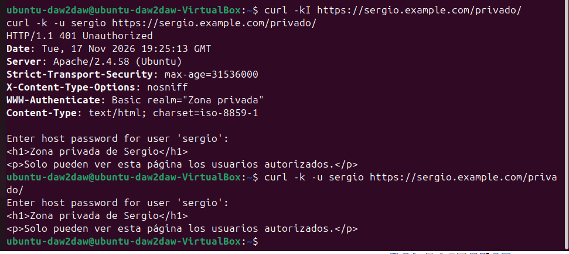

**Navegador.** Al entrar en `http://sergio.example.com`, Firefox redirige a `https://`, marca la conexión como «No seguro» y muestra el aviso «Advertencia: riesgo potencial de seguridad a continuación», porque el certificado es autofirmado. Tras pulsar **Avanzado** y **Aceptar el riesgo y continuar**, se carga la web por HTTPS.

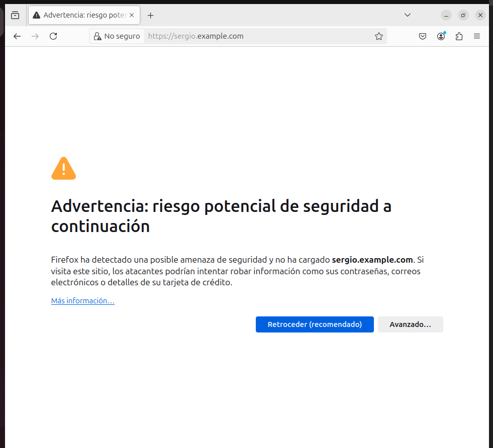

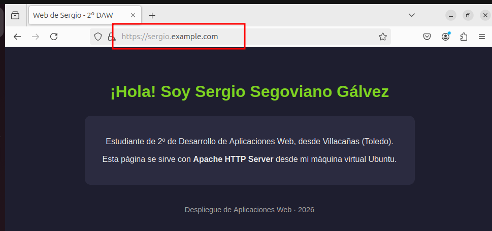

En la información del certificado se ve que el titular (nombre del asunto) y el emisor son los mismos, `sergio.example.com`, con una validez de un año y el dominio como nombre alternativo.

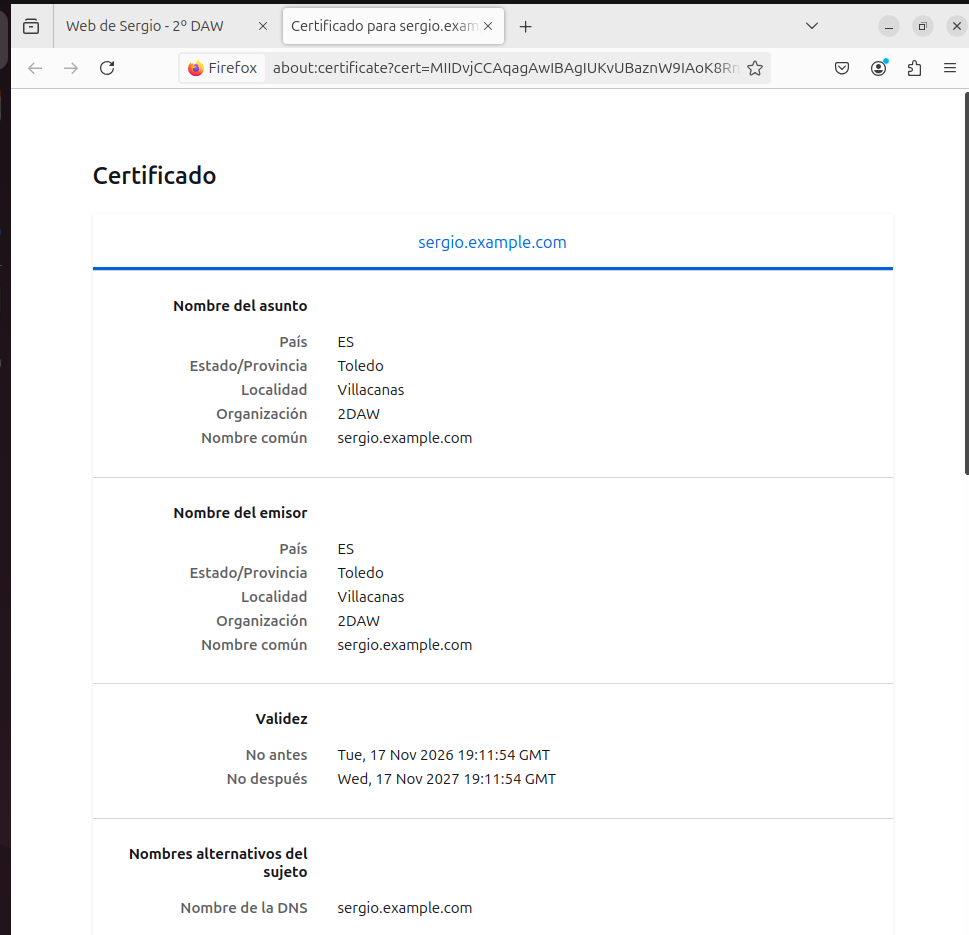

## Banco de pruebas

Pruebas realizadas en la máquina virtual (Ubuntu 24.04, Apache 2.4.58, Firefox y curl).

| N.º | Prueba | Resultado esperado | Resultado obtenido |
| --- | --- | --- | --- |
| 1 | `apache2ctl configtest` | Syntax OK | Correcto |
| 2 | `ss -tlnp` | Apache escucha en los puertos 80 y 443 | Correcto |
| 3 | `curl -I http://sergio.example.com` | 301 hacia `https://` | Correcto |
| 4 | `curl -kI https://sergio.example.com` | 200 OK con cabeceras de seguridad | Correcto |
| 5 | `curl -kI https://sergio.example.com/privado/` | 401 Unauthorized | Correcto |
| 6 | `curl -k -u sergio https://sergio.example.com/privado/` | Se ve la zona privada | Correcto |
| 7 | Entrar en `http://sergio.example.com` con Firefox | Redirige a HTTPS y muestra el aviso | Correcto |
| 8 | Aceptar el riesgo en Firefox | Se ve la web por HTTPS | Correcto |
| 9 | Ver el certificado en Firefox | Emisor y titular iguales | Correcto |

## Conclusiones

Se ha configurado HTTPS en Apache con un certificado autofirmado, un VirtualHost en el puerto 443 y la redirección permanente desde HTTP. Todo el tráfico del sitio, incluida la autenticación de la zona privada, viaja ahora cifrado.

El certificado autofirmado cifra la conexión igual que uno de una autoridad de certificación, pero el navegador no puede verificar la identidad del servidor y muestra un aviso. Es suficiente para un entorno de pruebas, pero en un servidor público habría que usar Let's Encrypt con Certbot, que en esta práctica no ha sido posible porque el dominio no es real ni accesible desde Internet.

**Dificultades encontradas:** la implementación no ha dado errores. Los únicos avisos han sido el AH00558, que ya aparecía en la práctica anterior y no afecta al funcionamiento, y la advertencia de Firefox, que es la esperada con un certificado autofirmado. Lo más delicado ha sido acordarse de copiar el bloque de la zona privada al nuevo VirtualHost, porque si no, al redirigir todo a HTTPS, la carpeta `/privado` habría quedado sin contraseña.

## Bibliografía

- The Apache Software Foundation. *SSL/TLS Strong Encryption: How-To*. https://httpd.apache.org/docs/2.4/ssl/ssl_howto.html (consultado el 17/11/2026).
- DigitalOcean. *How To Create a Self-Signed SSL Certificate for Apache in Ubuntu 22.04*. https://www.digitalocean.com/community/tutorials/how-to-create-a-self-signed-ssl-certificate-for-apache-in-ubuntu-22-04 (consultado el 17/11/2026).
- Let's Encrypt. *Challenge Types*. https://letsencrypt.org/docs/challenge-types/ (consultado el 17/11/2026).
